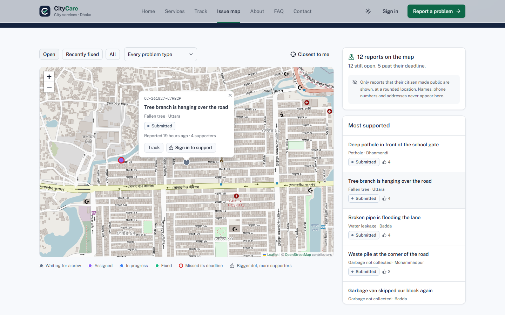
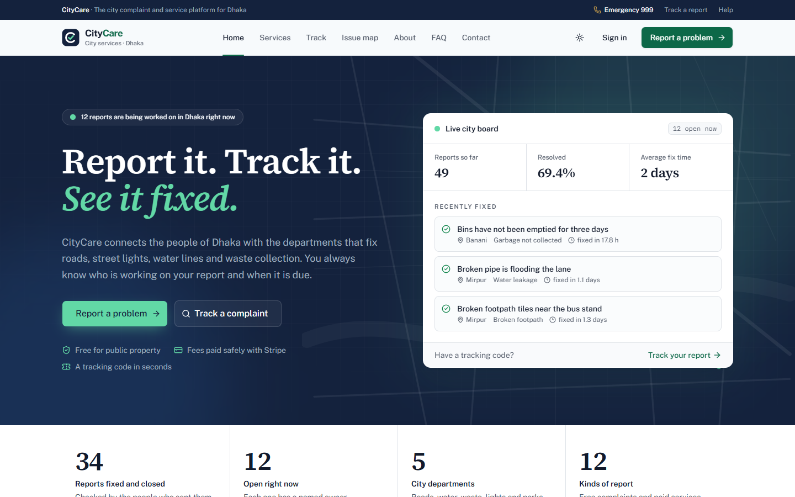
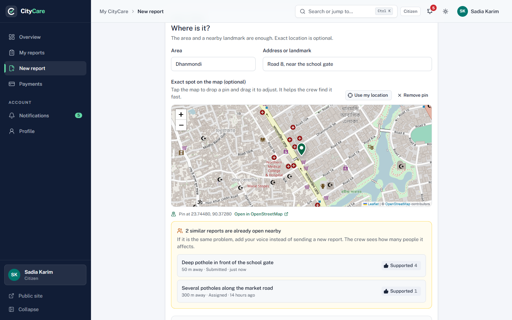
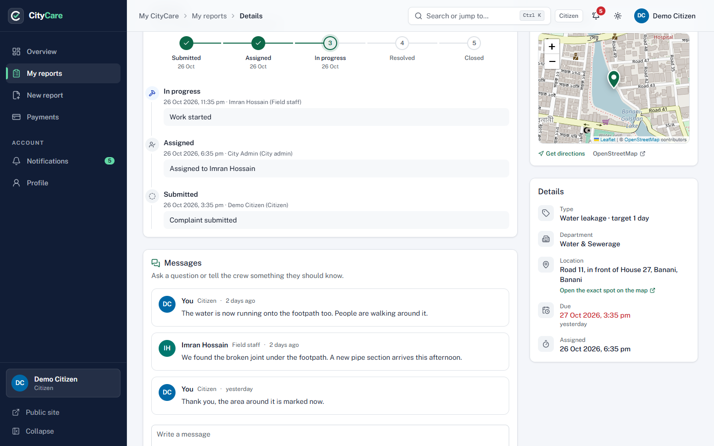
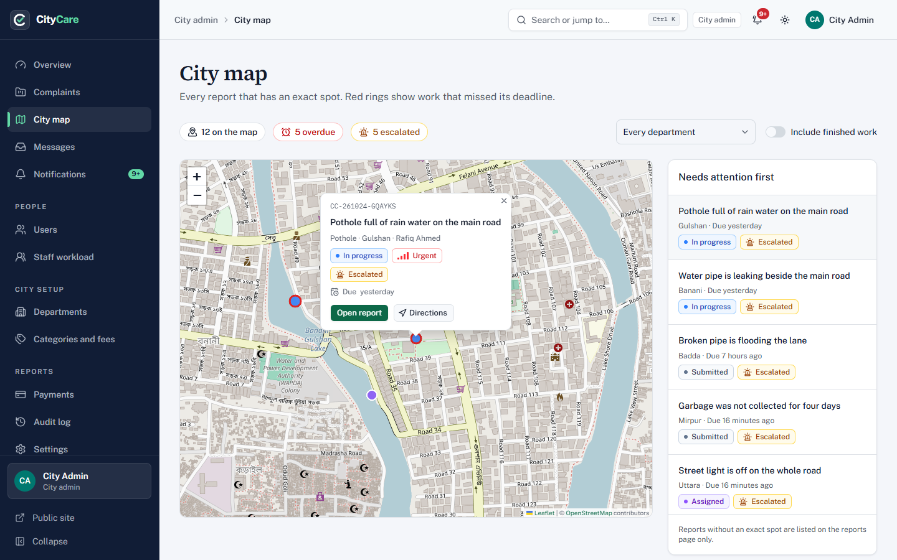
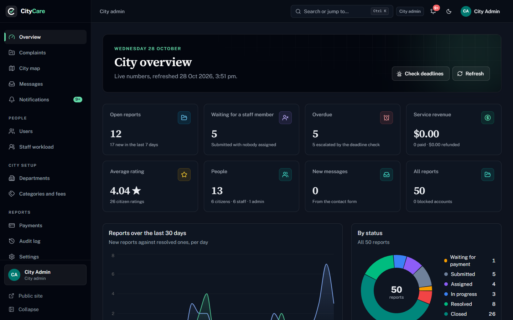
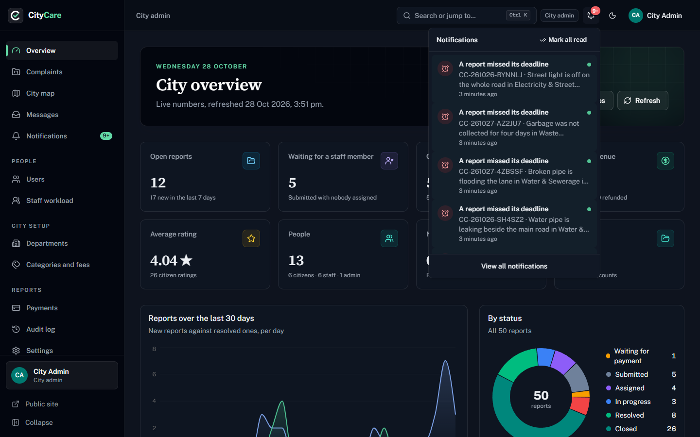
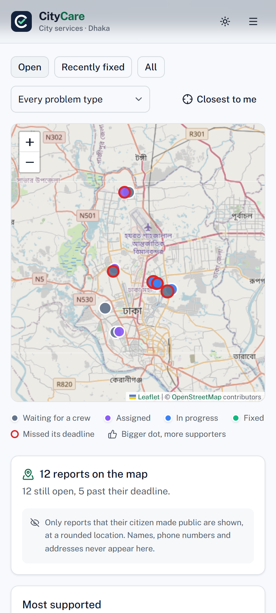
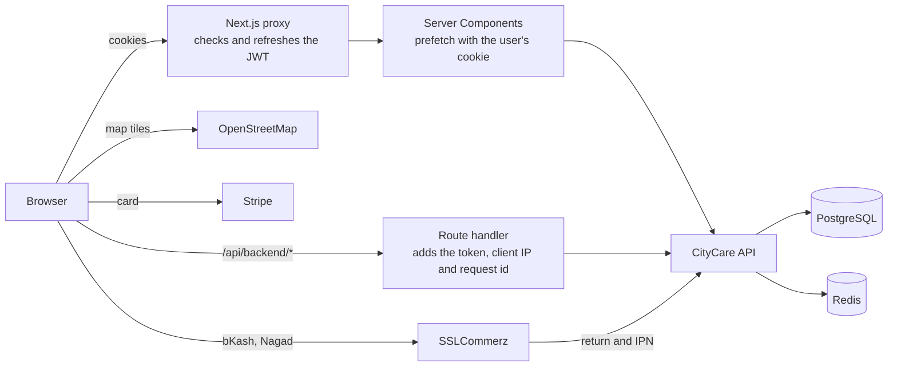

# CityCare

**Report it. Track it. See it fixed.**

[](https://github.com/ebrahim2355/citycare-frontend/actions/workflows/ci.yml)


CityCare is a city complaint and service request platform for Dhaka. Citizens report problems on public property (potholes, dark street lights, water leaks, missed garbage pickups) or book paid home services, pin the exact spot on a map and follow every step with a tracking code. Field staff work through their jobs by deadline. City admins assign the work, watch the deadlines and read the numbers.

This repository is the Next.js frontend. The API lives in [citycare-backend](https://github.com/ebrahim2355/citycare-backend).



## Live Demo

| Item | Link |
| --- | --- |
| Website | https://citycare-frontend-azure.vercel.app |
| API | https://citycare-backend.vercel.app |
| API docs (Swagger) | https://citycare-backend.vercel.app/api/v1/docs |
| Backend repository | https://github.com/ebrahim2355/citycare-backend |

The login page has one-click demo buttons for every role. You can also type the accounts:

| Role | Email | Password |
| --- | --- | --- |
| City admin | admin@citycare.com | Admin12345 |
| Field staff (Roads & Transport) | roads.staff@citycare.com | Staff12345 |
| Citizen | citizen@citycare.com | Citizen12345 |

Payments run in test mode. Pay by card with `4242 4242 4242 4242`, any future date and any CVC, or pick bKash or Nagad and press **Success** on the SSLCommerz sandbox page.

## Highlights

- **Four experiences in one app.** 40 pages for the public, citizens, field staff and city admins. The proxy keeps each role inside its own area.
- **A live map of the city.** Leaflet with OpenStreetMap powers the public issue map, the pin drop in the report wizard, a map on every report and a city map for staff and admins with overdue work ringed in red. Only reports that a citizen made public are shown, at a rounded location.
- **Fewer duplicate reports.** While a citizen reports, the wizard looks for the same problem nearby and offers "Me too" instead of a second report. More supporters make the dot on the map bigger.
- **Notifications and messages.** An in-app inbox with an unread badge and toasts, and a message thread on every report with internal notes that only the city team sees.
- **Deadlines that escalate.** A report that misses its deadline is flagged, raised in priority and shown with a badge to the team.
- **Secure by default.** Tokens stay in HTTP-only cookies behind a backend-for-frontend route, with a strict Content Security Policy, safe redirects and a reference id on every error.
- **Tested like a product.** 104 unit tests and 46 Playwright end-to-end tests run on every push. They cover the whole report journey against the real API, accessibility audits with axe and a phone layout.
- **Ready to ship.** GitHub Actions CI, a small Docker image from the standalone build, and Dependabot.

## Screenshots

| | |
| --- | --- |
|  |  |
| Home page with live city numbers | The report wizard finds the same problem nearby |
|  |  |
| A report with its progress, messages and map | The admin city map, most urgent work first |
|  |  |
| Admin overview in dark mode | The notification inbox |

<p align="center"></p>

## Roles

| Role | What they can do |
| --- | --- |
| **Citizen** | Report a problem in a five step wizard with photos and a pin on the map, support a report nearby instead of sending it again, pay for home services by card, bKash or Nagad, follow the timeline, message the crew, edit or cancel before assignment, rate the work, reopen within 7 days and get a notification at every step |
| **Field staff** | See jobs sorted by deadline and on a map, start and resolve them with a note and proof photos, leave internal notes for the city team, see performance charts and pause new jobs while on leave |
| **City admin** | Watch the live overview and the city map, assign by workload or by hand, move reports between departments, reject with an automatic refund, run the deadline check, export complaints and payments as CSV, manage users, departments, categories and fees, answer contact messages and read the audit log |

## Pages

| Area | Pages |
| --- | --- |
| Public | Home with live city numbers, Issue map, Services and fees, Track a report, About, FAQ, Contact |
| Auth | Login with one-click demo login and Google, Register, Forgot password, Reset password |
| Citizen | Overview, My reports, New report wizard, Report details, Notifications, Payments, Profile |
| Staff | Overview, My tasks, Task details, Map, Notifications, Performance, Profile and availability |
| Admin | Overview, Complaints, Complaint details, City map, Messages, Notifications, Users, Staff workload, Departments, Categories and fees, Payments, Audit log, Settings |
| Payment | Payment success, Payment cancelled |
| Shared | Custom 404, an error boundary for every area and a global error page |

## Tech Stack

| Part | Tools |
| --- | --- |
| Framework | Next.js 16 (App Router, Cache Components, Partial Prefetching), React 19, TypeScript (strict) |
| UI | Tailwind CSS 4, shadcn/ui on Radix, Lucide icons, next-themes for light and dark mode |
| Maps | Leaflet 1.9 and React Leaflet 5 with OpenStreetMap tiles, themed for light and dark mode |
| Data | TanStack Query 5 with server prefetching and hydration |
| Client state | Zustand (sidebar and the saved report draft) |
| Forms | React Hook Form with Zod, the same rules as the API |
| Charts | Recharts through the shadcn chart component |
| Auth | JWT access and refresh tokens in HTTP-only cookies, verified with jose in the proxy |
| Payments | Stripe Checkout for cards, SSLCommerz for bKash and Nagad (test mode) |
| Images | next/image with a Cloudinary loader |
| Testing | Vitest, Testing Library, Playwright, axe-core |
| Delivery | GitHub Actions, Docker, Vercel, Dependabot |

## Architecture



### Auth and route protection

- Login, register, Google sign in and password changes go through route handlers in `src/app/api/auth`. The tokens never reach browser JavaScript. They are stored in HTTP-only, SameSite cookies.
- `src/proxy.ts` verifies the access token with `jose` on every request, refreshes it when it is about to expire, and keeps each role inside its own area: `/dashboard` for citizens, `/staff` for staff and `/admin` for admins. A visitor without a session goes to `/login` and comes back to the same page after signing in. The return path is normalised and must stay on this site.
- Client components call `/api/backend/*`. This route handler adds the token from the cookie and forwards the request to the API. It also sends the real client IP with a shared key, so the API rate limits each visitor and not the frontend server. CSV exports are streamed through the same route.
- The UI changes with the role: the sidebar, the dashboards and every action button are shown only to the role that can use them. The API checks the role again on every request.

### Server and Client Components

- Pages are Server Components. Public pages read the catalog and the city numbers with `"use cache"`, so they are prerendered and served from the edge. When an admin changes a department or a category, the cache tag is revalidated and the services page updates within seconds.
- Dashboard pages prefetch their data on the server with the user's cookie and pass it to TanStack Query with `HydrationBoundary`. The first paint already has the data, and later filter changes are fetched in the browser.
- Client Components are used only for the interactive parts: tables with filters, forms, dialogs, maps, charts and the sidebar.
- Every data page has a `loading.tsx` skeleton, every area has an `error.tsx` boundary, and there is a custom `not-found.tsx`.

### Data, caching and URL state

- Filters, search, sorting and pagination live in the URL (`?status=SUBMITTED&page=2`), so a filtered view can be bookmarked or shared and the back button works.
- TanStack Query caches every list and detail view, keeps the previous page while the next one loads and refetches after every change.
- Optimistic updates: starting a job, changing a priority, blocking a user, turning a category on or off, staff availability and closing a message change the UI at once and roll back if the API refuses.

### Maps and community

- Maps load on demand with `next/dynamic`, so Leaflet is only downloaded on pages that show a map. They follow the size of their container and use the app's theme for popups and controls.
- The report wizard has a location picker: tap the map, drag the pin, use the device location, or move the map with the arrow keys and press Enter. The area is filled in from the pin.
- On the location step the wizard asks the API for open public reports within 300 meters. If the same problem is already there, the citizen can support it with "Me too".
- A report is public by default and can be made private at any time. Home service requests are always private. The public map never shows names, phone numbers or addresses, and the location is rounded to about 10 meters.

### Notifications and messages

- The API writes a notification in the same transaction as each step of a report, so the inbox always matches the timeline.
- The bell polls the unread count every 30 seconds, shows a toast with an "Open" action when something new arrives, and refreshes the lists that changed.
- Every report has a message thread between the citizen and the city team. Staff and admins can switch to an internal note that the citizen never sees.

### Forms

- All forms use React Hook Form and Zod. The rules (lengths, phone format, password strength, fees, SLA hours) match the backend validation, and field errors from the API are shown on the right input.
- The report wizard has five steps (what, details, where, photos, review). The draft is kept in a Zustand store backed by sessionStorage, so a reload does not lose the answers.
- Photos are checked for type and size before upload, shown as previews and uploaded with a progress bar.

### Payments

The citizen picks how to pay: card (Stripe Checkout), bKash or Nagad (SSLCommerz). The picker asks the API which methods are set up and turns off the ones that are not. It sits on the request page and in the last step of the wizard, which keeps the choice in its draft.

- **Card:** the frontend asks the API for a Stripe Checkout session and redirects to Stripe. Stripe sends the citizen back to `/payment/success?session_id=...` or `/payment/cancel?session_id=...`.
- **bKash and Nagad:** the API opens an SSLCommerz session and returns the link of the chosen wallet. SSLCommerz posts the result to the API, which checks it with the SSLCommerz validation API and then redirects the citizen to `/payment/success?tran_id=...` or `/payment/cancel?tran_id=...`.

The success page confirms the payment with the API and shows a receipt with the method and, for the wallets, the amount charged in taka. The cancel page closes the checkout, tells a failed payment from a cancelled one and offers to try the same method again or pay another way. The payment history shows the method of every payment and filters by it. If an admin rejects a paid request, the API refunds it automatically to the same card or wallet.

### Errors and security

- Every request through the frontend carries an `X-Request-Id`. When the server fails, the error screen shows a short reference that matches the API logs, so a support request can be traced.
- Security headers on every page: a Content Security Policy, HSTS, `X-Content-Type-Options`, `X-Frame-Options: DENY`, a strict referrer policy, a cross-origin opener policy and a permissions policy that only allows location for this site.

### Performance, SEO and accessibility

- Charts and maps are split into their own chunks. Fonts come from `next/font`, images use `next/image`, and photos are resized by Cloudinary for each screen size.
- Every public page has its own title, description and canonical link. The site has a generated Open Graph image, a sitemap, robots rules and a web manifest.
- The end-to-end suite runs axe on the main pages of every role and on the map popups in both themes. All motion turns off for visitors who ask for reduced motion.

## Design

- A formal city service look: navy for structure (the top bar, page title bands, the dashboard sidebar and the footer), a civic green for actions and brass for paid services. Status badges use one calm colour for each step of the workflow, and priority is shown with small signal bars.
- Public Sans for the interface, Source Serif 4 for headings and IBM Plex Mono for tracking codes and receipts.
- Light and dark mode share the same colour tokens in `src/app/globals.css`. Changing the theme spreads the new one in a circle from the toggle with the View Transitions API.
- A route progress bar, a branded loading screen, a skeleton for every page and a command palette (`Ctrl K` or `⌘ K`) that jumps to any page of your role and searches your reports.

## Testing

| Suite | Tools | What it covers |
| --- | --- | --- |
| Unit (104 tests) | Vitest, Testing Library, jsdom | Validation rules, safe redirects, URL filters, the API client and its errors, formatting, map helpers, notification links, the payment method picker and shared components |
| End to end (46 tests) | Playwright, axe-core | Sign in for every role, the full journey of a report (a citizen reports and pins it, an admin assigns it, staff resolve it, the citizen is notified and rates it), community support and duplicate hints, CSV exports and the deadline check, bKash and Nagad payments in the SSLCommerz sandbox, public pages and security headers, accessibility of the main pages, the payment picker and map popups, and a phone layout |

```bash
npm test                    # unit tests
npm run test:coverage       # unit tests with coverage
npx playwright install chromium
npm run test:e2e            # needs this app on http://localhost:3000 and the API with the demo data
```

Set `E2E_BASE_URL` to run the end-to-end tests against another address.

### Continuous integration

Every push and pull request runs three jobs in GitHub Actions:

1. **Quality**: ESLint, the TypeScript check and the unit tests with coverage.
2. **Build**: the production build and the Docker image.
3. **End to end**: starts PostgreSQL and Redis, checks out the backend, applies the migrations, seeds the demo data, starts the API and this app, and runs Playwright. The report, traces and server logs are kept when a test fails.

## Run It Locally

### With Docker

Start the [backend stack](https://github.com/ebrahim2355/citycare-backend#run-it-with-docker) first. It creates the `citycare` network with the API, PostgreSQL, Redis and Mailpit. Then, in this repository:

```bash
docker compose up -d --build
```

Open http://localhost:3000. The web container joins the same network and uses the same local secrets as the API by default. Card payments need Stripe keys and bKash and Nagad need an SSLCommerz store in the backend, and Google sign in needs the Node.js setup below, because the browser has to reach the API directly.

### With Node.js

You need Node.js 22 or newer and the [CityCare API](https://github.com/ebrahim2355/citycare-backend) running.

```bash
npm install
cp .env.example .env.local
npm run dev
```

| Variable | Description |
| --- | --- |
| `API_URL` | Base URL of the CityCare API, for example `http://localhost:5000/api/v1` |
| `JWT_ACCESS_SECRET` | The same secret as the API. The proxy uses it to verify the access token |
| `INTERNAL_API_KEY` | The same key as the API. Lets the API rate limit by the real client IP |
| `NEXT_PUBLIC_SITE_URL` | Public URL of this site, used for links, metadata and the payment return pages |

The API must list the frontend URL in its `CLIENT_URL` or `CORS_ORIGINS`, so payment and Google sign in can return to it.

| Script | What it does |
| --- | --- |
| `npm run dev` | Starts the development server |
| `npm run build` | Builds for production |
| `npm run start` | Runs the production build |
| `npm run lint` | Runs ESLint |
| `npm run typecheck` | Generates the route types and runs the TypeScript check |
| `npm test` | Runs the unit tests |
| `npm run test:e2e` | Runs the Playwright tests |

## Deployment

The live site runs on Vercel. Set the four variables above in the Vercel project, then deploy:

```bash
vercel --prod
```

The same app also ships as a container. The Dockerfile builds the standalone output, runs as a non-root user and has a health check:

```bash
docker build --build-arg NEXT_PUBLIC_SITE_URL=https://your.site -t citycare-frontend .
docker run -p 3000:3000 -e API_URL=... -e JWT_ACCESS_SECRET=... -e INTERNAL_API_KEY=... citycare-frontend
```

## Project Structure

```
src
├── app
│   ├── (public)          home, issue map, services, track, about, faq, contact
│   ├── (auth)            login, register, forgot and reset password
│   ├── (app)             dashboard shell
│   │   ├── dashboard     citizen pages
│   │   ├── staff         staff pages
│   │   └── admin         admin pages
│   ├── payment           success and cancel pages for Stripe and SSLCommerz
│   └── api               auth route handlers and the backend proxy route
├── components            ui (shadcn), map, community, notifications, complaints, dashboard, charts, layout, shared
├── hooks                 session, url filters, mutations, uploads, checkout, notifications
├── lib                   api client, server fetcher, query options, validations, filters, geo, roles
├── stores                Zustand stores
├── types                 API response types
├── instrumentation-client.ts   starts the route progress bar on navigation
└── proxy.ts              route protection and token refresh
tests
├── unit                  Vitest
└── e2e                   Playwright
```
